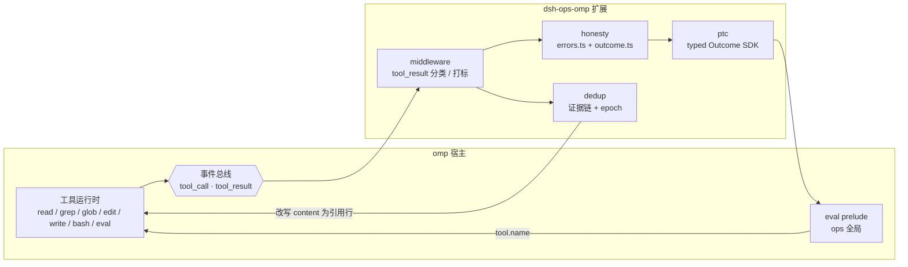
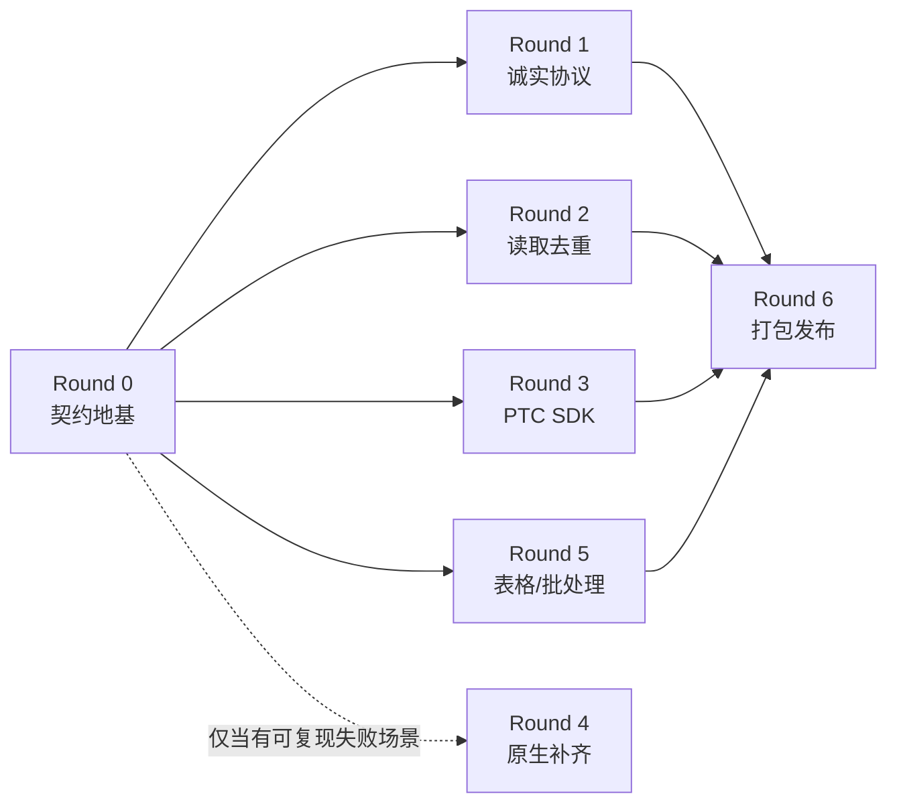

# dsh-ops → omp 重构与移植长期计划

> 状态：规划稿（Round 0 未开始）。本文件是工作文档，不随包发布，因此用中文书写；内容毕业进 `docs/` 时按
> `AGENTS.md` 的双语规则补齐英文版。
>
> 结论先行：**可行，且比在原宿主上更省力——但"照搬"是错的。** dsh-ops 的价值不在它的 15 个文件工具
> （omp 内置工具在这些面上已经更强），而在它的**诚实协议**（Outcome / coverage / effectState / retry）
> 与**上下文去重算法**。移植策略应为「语义移植 + 少量原生补齐」，而不是「工具平移」。

---

## 1. 两个宿主的结构差异

dsh-ops 是给 DSH 打的补丁，很多代码是为了绕开 DSH 缺失的抽象。omp 把这些抽象做成了公开 API，
于是那部分代码在 omp 上变成纯负债。

| 维度 | DSH（dsh-ops 当前宿主） | omp | 移植结论 |
|---|---|---|---|
| 工具注册 | `ctx.tools.register`，schema 子集（`JsonSchemaNode`），`output.schema` + `render` | `registerTool(ToolDefinition)`，omptype/TypeBox，`content` + `details` | schema 层重写，约 400 行 |
| 进程模型 | 每次调用 spawn Rust worker，stdin/stdout JSON 信封，watchdog 退出码 124 | 进程内 native addon（N-API）+ Bun 运行时 | **worker 边界整体删除**（协议 crate 一并退役） |
| 沙箱 / PTC | `run_code` 沙箱 + 独立 worker + 能力重检 | `eval`（Python kernel / Bun worker）+ `tool.<name>` 桥 + prelude | PTC 层改写为 prelude 库 |
| Bash | 自建 bash 阶梯（config→provisioned→bundled→PATH→well-known）、自管 subprocess/jobs | 内嵌 brush shell、PTY、`proc://` 作业、审批、`bashInterceptor` | **整层删除**（约 2,300 行） |
| 渐进披露 | `ops_discover_tools` + 「激活永远是下一个模型步」 | `loadMode: 'discoverable'` + `xd://` 挂载 | **整层删除**（约 350 行） |
| 官方工具遮蔽 | `replaceTools` + 要求 OPS 自有 provider，否则 READINESS_BLOCKED | `setActiveTools` / `getActiveTools`，影子工具用 `ctx.invokeTool` 委派 | 不需要（见 §6） |
| 输出上限 / 溢出 | 自建 `ref://` store + spill + TTL | `artifact://` + `session.allocateOutputArtifact` + `tools.artifactSpillThreshold` | 只移植引用语义，不移植存储 |
| 编辑 | 自建 write/edit，SHA-256 `expectedRevision` CAS | hashline（`[path#TAG]`）+ tree-sitter 块锚点 + seen-line 校验 | 只补 CAS / 锁 / ACL |
| 文档 | 自研 PDF / DOCX / CSV Rust 解析 | `read` 已覆盖 pdf/doc/docx/ppt/pptx/xls/xlsx/rtf/epub + 归档 + SQLite + 图片 + 视频 | 需实测对比，可能只补严格 CSV/TSV |

规模对照（本仓实测）：`src/` 127 个 `.ts/.tsx` = 11,186 行；`native/` 45 个 `.rs` = 8,471 行；
`test/` 127 个套件 = 23,660 行。其中在 omp 上**没有归宿**的约 7,100 行 TS 与整个 IPC 层。

---

## 2. 资产盘点：真正独特的部分

按「是否 omp 已有」逐项裁决。**只有 A 类值得原样移植。**

### A 类 · 直接移植（纯函数，无宿主依赖）

| 资产 | 位置 | 行数 | 为什么独特 |
|---|---|---|---|
| 错误策略表 | `src/kernel/errors.ts` | 64 | `ERROR_POLICIES` 把「失败状态 × 重试建议」钉死；`errorPolicy()` 让 **effectState 压过 retry**：效果未知时永远回答 `unknown`/`never`。omp 完全没有等价物。 |
| Outcome 契约 | `src/kernel/outcome.ts` | 47 | `Outcome<T> = completed \| partial(+continuation) \| rejected/conflict/error/unknown`；`CoverageMeta.truncatedBy` 四值枚举；`SearchExecutionReport` 用联合类型禁止「扫描未完成却声称总数」。 |
| PTC 规范化器 | `src/modes/ptc/outcome.ts` | 79 | `toOutcome()` 把任意 worker 回包归一成 Outcome：缺回执→`RESULT_UNKNOWN`、未识别状态→unknown、不完整且无安全游标→带数据的错误（绝不伪造分页）。 |
| 能力目录 | `src/capabilities/{file,ptc,sdk,documents,registry,types}.ts` | 386 | 20 条能力的单一事实源：`parameters` / `description` / `output` / `mutates` / `concurrencySafe` / `availability`。omp 侧应保留这个「数据与注册分离」的形状。 |

### B 类 · 算法移植（需重写证据链，逻辑保留）

| 资产 | 位置 | 行数 | 移植要点 |
|---|---|---|---|
| 读取去重 | `src/modes/native/read-dedup.ts` + `read-observation.ts` + `read-evidence.ts` | 130 + ~70 + 53 | 核心是「正向证据」：只有同一 callId、逐字节相同的 body、同一 message 身份、同一 session 代际、文件 identity（dev/ino/size/mtimeNs/ctimeNs）+ revision 全部吻合，才允许把正文换成引用行。omp 缺 `surface.contentGeneration`，用「非只读工具调用即 epoch++」替代。 |
| 搜索覆盖度 | `src/capabilities/file.ts`（`SEARCH_OUTPUT`）+ `native/crates/ops-search/{scan,paging}.rs` | 137 + ~ | omp `grep` 的 `details` 只有 `fileLimitReached`/`perFileLimitReached`/`truncated`，**没有** `scanComplete`/`pageComplete`/`skipReasons`/`matchedObserved`，也没有「总数只在完整扫描后才存在」的规则。 |
| 发布原子性 | `native/crates/ops-files/{file_publication,file_update_lock}.rs` + `windows-metadata/` | ~ | update-lock sidecar（`0600`，名字 = `sha256(小写 basename)`）、bind-before-publish（重开名字比对 dev+inode）、只 unlink 已绑定的 inode、Windows 保留 owner/group/有序 DACL、只读文件拒绝覆盖、不支持流/EA 时 `METADATA_UNSUPPORTED` fail-closed。omp 的 `write` 文档未声明这些契约。 |

### C 类 · 有价值但成本高（Round 5）

- `ops-results` 的 `ref://` 引用语义（`ttlMs` / `schemaVersion` / `producerTool` / `totalItems` / `preview`）→ 作为 `artifact://` 的元数据附加。
- 严格表格解析（`ops-documents` 的 CSV/TSV：保留引号内换行、物理 `lineStart`/`lineEnd`、1024 列、BOM 冲突即失败、不做类型推断）→ omp `read` 走 markit 转换，严格性可能不足。
- `batch` 的 plan / run / resume 三段式 + `protect` 保护列表 + `operationsRef` 审计。

### D 类 · 不移植（在 omp 上无归宿）

`src/shells/*`（2,321）· `src/cli/*`（1,352）· `src/session-shells.ts`（240）· `src/bash-ipc.ts`（270）
· `src/discovery/*`（315）· `src/official-tool-hiding.ts`（178）· `src/panel/*`（813）· `src/tui/*`（428）
· `src/settings/*`（413）· `src/profiles/*` · `src/components/*`（155）· `src/compat`（23）
· `src/worker-protocol.ts` / `src/worker-boundary.ts` / `src/file/worker.ts` / `src/ptc/worker.ts`
· `native/src/main.rs` + `native/crates/ops-protocol`（信封协议）

理由：这些全部是「补 DSH 缺的抽象」或「DSH 专属 UI/供应链」。omp 有内嵌 brush shell、PTY、`proc://`
作业、`artifact://`、TUI 渲染器与 marketplace，重造只会与宿主打架。

---

## 3. 目标架构（omp 侧）

一个扩展包，四个模块，全部可独立开关：



- **`honesty/`**：纯函数层。`errorPolicy(code, effectState)` + `toOutcome(tool, args, details)`。无副作用、可单测。
- **`middleware/`**：注册 `tool_result` 处理器。失败时补 `details.outcome = {effectState, retry, nextAction}` 并追加一行
  `[effect: … · retry: …]`；成功时**不碰 content**。幂等（已存在 `details.outcome.v1` 则跳过）。
- **`dedup/`**：`tool_result` 处理器，只对 `read`/`grep` 生效。命中证据链时把 `content` 换成引用行，保留 `[path#TAG]`
  头；`details.displayContent` 保持全文，人类视角不丢信息。
- **`ptc/`**：`ops` 全局（`await ops.read({…}) → Outcome<ReadData>`），底层仍调 `tool.<name>`。另附 `.py` / `.ts` 两个
  可直接 `%load` 的 helper 文件，作为 prelude 不可用时的退路。

设计约束（写进代码注释，作为审查点）：

1. 中间件必须**全包 try/catch 并直通**：omp 扩展无隔离，一个未捕获异常会拆掉整个会话。
2. 去重只做「变短」的单调操作；任何不确定都返回 `undefined`（不改）。
3. 不依赖 `details` 的内部形状作为唯一信号：字段缺失即降级为直通。
4. 不改写 `isError`，不改写 `details.displayContent`，不改写 `details.truncation`。

---

## 4. 五个突破点

**B1 · 语义移植而非代码移植。**
omp 的 `read` 已覆盖 15 种格式（归档 15 族 / SQLite / 图片 / 视频 / PDF / Office / IDA / URL），`edit` 有 tree-sitter
块锚点，`bash` 有 brush + PTY + 作业。搬 15 个 `ops_*` 文件工具是**净退化**。真正独有的是诚实协议 →
用 `tool_result` 中间件交付，**一个新工具都不用写**。

**B2 · omp 的 `tool_call` / `tool_result` 正是 dsh-ops 当年要打补丁的缝。**
dsh-ops 不得不自建 `tools.restrict`、`output.schema`、prompt section 才拿到等价能力；omp 把这三件事做成公开
事件（`tool_result` 可改 `content`/`details`/`isError`）、`setActiveTools`、`registerTool` 的 `loadMode`。**同一套语义在
omp 上的实现成本比原宿主更低。**

**B3 · `eval` + `tool.<name>` = 免费 PTC。**
不需要新沙箱、不需要 IPC、不需要 worker 生命周期与 watchdog。PTC 的 18 个 API 变成 prelude 里的 typed helper，
`Outcome` 直接以对象形态进代码。dsh-ops 为 PTC 付出的 646 行桥接 + 独立进程 + 能力重检，在 omp 上是零。

**B4 · 去重可以纯输出层实现。**
omp 在 `execute` 阶段就记录了 seen lines 与 `[path#TAG]` 快照，`tool_result` 阶段改写 `content` **不会**破坏
`edit.enforceSeenLines` 的校验（记录已发生）。加上 `details.displayContent` 与 `content` 分离，人类看到的仍是全文。
这是 dsh-ops 在 DSH 上做不到的「零侵入去重」。

**B5 · Rust 只在三个地方值得进 native。**
发布原子性（update-lock + bind-before-publish + DACL）、覆盖度精确的扫描计数、严格 CSV/TSV。其余 8,471 行 Rust
的价值在**语义**而非 IPC，随 worker 协议一起退役。omp 已有 `file_lock`、`iofs`、`edit`、`pdf`、`html`、`summary`
等原生模块可复用。

---

## 5. 轮次、切片与 PR 切分

**组织原则**：一轮 = 一个可发布的增量；一轮内的切片**并行开发、各自一个 PR**；每个切片独占一组文件，
互不重叠，因此合并顺序不影响正确性；轮末由集成方（我）跑统一验收。

### 5.0 三条并行化硬规则

1. **一个 PR = 一个切片 = 一组独占文件。** 切片的文件清单写进它的 issue，PR 只准改清单内的文件。
   任何跨切片的改动必须先回到契约层（Round 0 的文件），由契约 PR 单独改。
2. **接口先冻结，切片只实现接口。** Round 0 落地全部共享类型与骨架；之后的切片只填自己的实现，
   不允许修改共享类型的形状（要改就开一个契约 PR，并在同一轮内先合）。
3. **全局只有一个 `tool_result` 注册点。** 它由骨架拥有，按固定顺序调用各切片注册的**纯 transform**。
   切片不得自己 `pi.on('tool_result', …)`——这既避免链式中间件互相踩（风险 R2），
   也让「谁改了 content」始终可追。

补充规则：**按领域切片，不按层次切片。** 例如诚实协议按工具族切成 `rules/bash.ts`、`rules/file.ts`、
`rules/search.ts`、`rules/eval.ts`，而不是切成「分类层 / 渲染层 / 装配层」——后者会让三个切片都改同一个文件。

### 5.1 仓库形态与目录

移植产物放在本仓的 `omp/` 子包，与 `src/`（DSH 插件）**零依赖、零引用**：

```
omp/
  package.json          # 独立依赖；omp 插件的 manifest 在 package.json#omp
  src/
    kernel/             # 纯函数：outcome / errors / coverage
    host/contracts.ts   # 唯一知道 omp 工具 details 形状的地方
    pipeline.ts         # 唯一 tool_result 注册点 + Transform 注册表 + feature 开关
    rules/              # 按工具族切分的分类规则
    dedup/              # 读取去重
    ptc/                # typed Outcome SDK（js / py）
    extension/index.ts  # factory：装配、开关、kill switch
  test/                 # node --test（Node 24 原生类型擦除，无需 Bun）
docs/porting/           # spike 报告、规格映射表
```

理由：`src/` 保持原样继续发布 DSH 插件；`omp/` 可独立删除而不影响它；`scripts/check-file-size.mjs`
自动覆盖 `omp/` 下的 `.ts`。若你更希望另起仓库，把 `omp/` 整体搬走即可，轮次与切片不变。

### 5.2 Round 0 冻结的接口（唯一串行点）

这五份文件是并行的前提。它们定稿后，后续所有切片可以同时开工。

```ts
// omp/src/kernel/outcome.ts —— 逐字移植 src/kernel/outcome.ts
export type EffectState = 'none' | 'applied' | 'partial' | 'unknown'
export type RetryPolicy = 'never' | 'after-input-change' | 'after-state-change' | 'bounded-transient'
export type FailureStatus = 'rejected' | 'conflict' | 'error' | 'unknown'
export interface OpsErrorPayload { code: string; effectState: EffectState; retry: RetryPolicy; message: string; nextAction?: string }
export interface CoverageMeta {
  scannedFiles: number; matchedCount: number; isComplete: boolean
  truncatedBy?: 'scan-budget' | 'output-budget' | 'time-limit' | 'row-limit'
}
export type Outcome<T> =
  | { status: 'completed'; data: T; coverage?: CoverageMeta & { isComplete: true } }
  | { status: 'partial'; data: T; coverage: CoverageMeta & { isComplete: false }; continuation: string }
  | { status: FailureStatus; error: OpsErrorPayload; data?: T }

// omp/src/kernel/errors.ts —— 逐字移植；ERROR_POLICIES 表不得增删改
/** 效果优先于重试建议：effectState 为 unknown 时，永远返回 unknown/never。 */
export function errorPolicy(code: string, effectState?: EffectState): { status: FailureStatus; retry: RetryPolicy }

// omp/src/host/contracts.ts —— 与 omp 形状的唯一边界
export interface ToolObservation {
  readonly tool: string                 // 'read' | 'grep' | 'glob' | 'bash' | 'edit' | 'write' | 'eval' | …
  readonly args: unknown
  readonly content: readonly { type: string; text?: string }[]
  readonly details: unknown
  readonly isError: boolean
}
/** 形状不认识就返回 undefined：调用方必须原样直通，绝不猜测。 */
export function observe(raw: unknown): ToolObservation | undefined
export function bashFacts(o: ToolObservation): { exitCode?: number; timedOut: boolean; aborted: boolean; denied: boolean } | undefined
export function readFacts(o: ToolObservation): { paths: readonly string[]; truncated: boolean; selectorKind: 'none'|'range'|'raw'|'other' } | undefined
export function grepFacts(o: ToolObservation): { matchCount: number; fileCount: number; truncated: boolean; fileLimitReached: boolean; perFileLimitReached: boolean; linesTruncated: boolean; missingPaths: number } | undefined

// omp/src/pipeline.ts —— 唯一注册点
export type FeatureFlag = 'honesty' | 'dedup' | 'ptc'
export interface MutableResult { content: { type: string; text?: string }[]; details: unknown; isError: boolean }
export interface Transform {
  readonly name: string
  readonly features: readonly FeatureFlag[]
  /** 必须是全函数：不得抛异常，不得放大 content，不得改 isError。 */
  apply(o: ToolObservation, out: MutableResult): void
}
export function registerTransform(t: Transform): void
export function runTransforms(o: ToolObservation, out: MutableResult, enabled: ReadonlySet<FeatureFlag>): void

// omp/src/dedup/types.ts —— 去重切片的共享形状
export interface FileIdentity { dev: bigint; ino: bigint; size: bigint; mtimeNs: bigint; ctimeNs: bigint }
export interface ReadRecord {
  readonly agentKey: string
  readonly epoch: number
  readonly key: string          // exactJson([tool, args, observations])
  readonly body: string         // 首次下发的逐字正文
  readonly bytes: number
  readonly identity: FileIdentity
  readonly revision: string     // 64 位小写 hex，缺失即不可去重
  readonly messageId?: string
  readonly callId?: string
}
export interface DedupTarget {
  readonly tool: string
  /** 从一次成功结果里取出可去重的正文与 key；不满足全部前提则 undefined。 */
  extract(o: ToolObservation): { body: string; key: string; paths: readonly string[]; revision: string } | undefined
}
export interface Rewrite { readonly text: string }   // 只在严格短于原正文时产生
```

骨架的装配方式（Round 0 一次定死）：`extension/index.ts` 静态 import `rules/index.ts`、`dedup/index.ts`、
`ptc/index.ts` 三个 barrel，各自导出 `transform` 数组；barrel 与其中的空实现由 Round 0 一并创建，
后续切片只填自己那一个文件。**轮末门禁会拒绝任何残留的空 transform。**

### 5.3 轮次表

每个 PR 的规模按 `AGENTS.md` 的「≤1000 实现行」留足余量；并行度写在小节标题里。

#### Round 0 · 契约地基（串行，2 个 PR）

原设计是 1 个 PR，实际执行时拆成两个：0a 只含类型与骨架签名，体量小、当天可合，**R1/R2 在 0a 合入后即可开工**；
0b 补齐运行时与探针，可与 R1/R2 并行。

| PR | 切片 | 独占文件 | 依赖 | 规模 |
|---|---|---|---|---|
| `contract/spine` (0a) | `omp/` 包骨架 + kernel 三件套 + host 契约类型 + pipeline + dedup 类型 + 空 barrel + 最小 extension factory | `omp/package.json`、`omp/tsconfig.json`、`omp/src/kernel/**`、`omp/src/host/contracts.ts`、`omp/src/pipeline.ts`、`omp/src/dedup/types.ts`、`omp/src/{rules,dedup,ptc}/index.ts`、`omp/src/extension/index.ts` | 无 | ~450 行 |
| `contract/runtime` (0b) | `observe()` 与三个 facts 提取器的运行时守卫、`runTransforms` 执行器、kernel 规格测试、七条假设探针 | `omp/src/host/guards.ts`、`omp/src/pipeline-runtime.ts`、`omp/test/**`、`docs/porting/spike-report.md` | 0a | ~400 行 |

验收（0a）：`node --test` 绿；`omp plugin link` 装载后**什么都不做**。
验收（0b）：七条假设逐条给出「实测通过 / 证伪 + 证据」；`kernel-errors` / `kernel-types` 的规格全部映射成断言。
**两个 PR 都不对用户发布。**

#### Round 1 · 诚实协议（5 个 PR 并行）

| PR | 切片 | 独占文件 | 依赖 | 断言 |
|---|---|---|---|---|
| `honesty/bash` | 退出码 / 超时 / 中止 / 拒绝 → effectState+retry | `omp/src/rules/bash.ts` | R0 | 退出码非零必须 `effectState:'unknown'` + `retry:'after-input-change'`（文档化的例外）；超时/中止不得变成 `EXIT_CODE` |
| `honesty/file` | edit/write/read 失败分类 | `omp/src/rules/file.ts` | R0 | 陈旧 hashline tag、seen-line 拒绝、非普通文件、编码错误各自映射正确；**写入可能已发生时不得建议重试** |
| `honesty/search` | grep/glob 覆盖度推导 + `SEARCH_STALE` | `omp/src/rules/search.ts` | R0 | `!truncated && !fileLimitReached && !perFileLimitReached && !missingPaths` 才算 `isComplete`；**构造 >2000 匹配的目录**验证原生 `maxCount` 截断是否会谎报完整 |
| `honesty/eval` | eval/task/tool 错误分类 | `omp/src/rules/eval.ts` | R0 | `ToolError` / 取消 / 超时 / 内核崩溃（JS worker 被终止）各自映射；崩溃必须是 `unknown` |
| `honesty/render` | 单行提示渲染 + `details.outcome.v1` 幂等标记 | `omp/src/render/outcome-line.ts` | R0 | 二次运行不重复追加；成功结果**一个字节都不改**；只缩不增 |

**Round 1 结束即可发布**——这是第一个对用户有价值的增量，且不依赖去重。

#### Round 2 · 读取去重（5 个 PR 并行；与 Round 3 可同时进行）

| PR | 切片 | 独占文件 | 依赖 | 断言 |
|---|---|---|---|---|
| `dedup/store` | 有界记录（16 agent / 32 条 / 2 MiB）+ epoch + 失效 | `omp/src/dedup/store.ts` | R0 | 任何非只读工具调用后 epoch++，全部记录失效；超限按 FIFO 淘汰 |
| `dedup/evidence` | 文件 identity + key 构造 | `omp/src/dedup/evidence.ts` | R0 | dev/ino/size/mtimeNs/ctimeNs 任一不符即拒绝去重；revision 缺失即拒绝 |
| `dedup/rewrite` | 引用行生成 + 单调缩短保证 | `omp/src/dedup/rewrite.ts` | R0 | 新正文字节数必须严格小于原正文，否则返回 undefined（不改） |
| `dedup/target-read` | 从 read 结果提取 body/key | `omp/src/dedup/targets/read.ts` | R0 | 截断结果、hex 视图、多文件部分失败一律不参与去重 |
| `dedup/target-grep` | 从 grep 结果提取 body/key | `omp/src/dedup/targets/grep.ts` | R0 | 分页结果与 `No matches found` 不参与去重 |

#### Round 3 · PTC SDK（5 个 PR 并行；与 Round 2 可同时进行）

| PR | 切片 | 独占文件 | 依赖 | 断言 |
|---|---|---|---|---|
| `ptc/outcome` | 工具结果 → Outcome | `omp/src/ptc/outcome.ts` | R0 | 缺回执 → `RESULT_UNKNOWN`；未识别状态 → unknown；不完整且无安全游标 → 带数据的错误 |
| `ptc/continuation` | 分页 / 续跑规则 | `omp/src/ptc/continuation.ts` | R0 | 未完成扫描必须给 `partial` + `continuation`，且**不得**出现 `matchedTotal` |
| `ptc/js` | JS helper `ops` | `omp/src/ptc/js/ops.ts` | R0 | `await ops.grep({...})` 返回 Outcome；底层仍走 `tool.grep` |
| `ptc/py` | Python helper `ops` | `omp/src/ptc/py/ops.py` | R0 | 与 JS 版字段逐一对齐；分页语义一致 |
| `ptc/prelude` | 注册 / 发现 / 降级 | `omp/src/ptc/prelude.ts` | R0 | prelude 不可用时自动降级为 `%load` 文件方案并给出提示 |

#### Round 4 · 原生补齐（0–2 个 PR，**先证伪再动手**）

决策规则见 §5.7。没有可复现的失败场景 → 本轮回 0 个 PR，直接跳过。

#### Round 5 · 表格与批处理（4 个 PR 并行，可选）

| PR | 切片 | 独占文件 | 断言 |
|---|---|---|---|
| `table/parse` | 严格 CSV/TSV 解析 | `omp/src/table/parse.ts` | 引号内换行保留 `lineStart`/`lineEnd`；BOM 冲突即失败；不做类型推断 |
| `table/tool` | `ops_read_table` 工具 | `omp/src/table/tool.ts` | 1024 列上限；行分页不能跳过扫描缺口 |
| `batch/plan` | plan / run / resume 状态机 | `omp/src/batch/plan.ts` | 中断后 resume 不重复执行已完成项 |
| `batch/journal` | 审计日志与 `protect` | `omp/src/batch/journal.ts` | 受保护路径被改写时整批拒绝 |

#### Round 6 · 打包发布（3 个 PR 并行）

| PR | 切片 | 独占文件 | 断言 |
|---|---|---|---|
| `release/manifest` | `package.json#omp` + feature bracket + 开关 | `omp/package.json`、`omp/src/extension/flags.ts` | `pkg[honesty]` 只启用诚实协议；`pkg[]` 全关时零副作用 |
| `release/docs` | 双语文档 + CHANGELOG | `docs/porting/*.md`、`docs/porting/*.zh.md` | 中英同 PR，内容一致 |
| `release/gate` | 发布门禁 | `scripts/check-omp.mjs` | 干净机器 `omp plugin install <spec>` 后工具可用 |

#### 汇总：并行度、可发布性与依赖

| 轮 | 切片数 | 可并行 | 依赖 | 单人折算 | 对用户可发布 |
|---|---|---|---|---|---|
| 0 契约地基 | 1 | — | — | 3–5 天 | 否（内部骨架） |
| 1 诚实协议 | 5 | 全并行 | R0 | 1.5 周 | **是** |
| 2 读取去重 | 5 | 全并行，可与 R3 同期 | R0 | 1.5 周 | **是** |
| 3 PTC SDK | 5 | 全并行，可与 R2 同期 | R0 | 1.5 周 | **是** |
| 4 原生补齐 | 0–2 | 全并行 | 失败场景 | 0–1 周 | 视场景 |
| 5 表格/批处理 | 4 | 全并行 | R0（+R1 复用 Outcome） | 2 周 | **是** |
| 6 打包发布 | 3 | 全并行 | R1 起任意轮 | 1 周 | 发布 |

关键路径：`R0 → R1 → R6`，约 3–4 周；R2/R3 与 R5 全部挂在 R0 之后（R5 另复用 R1 的 Outcome 类型），**互不阻塞**。
因此 4 个开发者并行时，总工期约等于关键路径（3–4 周），而不是 10 周。

依赖图：



**注意 R2 与 R3 的独立性**：去重只读成功结果、只缩不增；PTC SDK 只读失败与覆盖度信息、不改 `content`。
两者共用骨架的 `runTransforms` 顺序（去重先、PTC 后），因此可以同时开工。

### 5.4 七条假设（Round 0 的探针清单）

| # | 假设 | 证伪后果 |
|---|---|---|
| H1 | 扩展的 `tool_result` 处理器能改写**内置** `read` 的 `content` | 去重层不成立，只能降级为 `additionalContext` 提示（收益大打折扣） |
| H2 | `read` 在 `execute` 阶段记录 seen lines，晚于它的 `content` 改写不影响 `edit.enforceSeenLines` | 去重与编辑安全冲突，需改为「只在无编辑意图时去重」 |
| H3 | `details.displayContent` 与 `content` 分离，改 `content` 不影响 TUI 渲染 | 去重会让人类看不到内容，须放弃或加 UI 开关 |
| H4 | 扩展能从 `tool_result` 拿到 `details` 并附加 `details.outcome` 而不被后续处理器覆盖 | 诚实协议只能走 `additionalContext`，Round 3 的 typed 消费端失效 |
| H5 | `eval` 能注入 `ops` 全局（extension prelude）或至少 `%load` 一个 helper 文件 | Round 3 退化为纯 helper 文件方案（可接受，但文档与入口需改） |
| H6 | marketplace 安装会执行插件自身的 `bun install`（即带原生依赖的插件可走 marketplace） | 只能走 `omp plugin install <npm\|git>`；marketplace 仅适合零依赖插件，Round 6 的发布形态要改 |
| H7 | 安装期 `#validateInstalledExtensions` 容忍 factory 里注册事件处理器（不视为初始化失败） | 注册必须推迟到 `session_start`，Round 0 的装配方式与测试方式都要改 |

### 5.5 PR 契约（每个切片都必须满足）

1. 一个 issue 先落地，写明：切片名、**独占文件清单**、依赖的契约版本、验收断言、规模预算。PR 必须 link 并 claim 它。
2. 分支 `slice/<round>-<name>`；提交信息用祈使句英文，例如 `feat(honesty): classify bash exit codes`。
3. PR 正文填 `.github/PULL_REQUEST_TEMPLATE.md`，Validation 段贴**真实命令输出**（pass/skip/fail 计数）。
4. 新增行为必须有一条「回退即失败」的断言；不得有静默跳过。
5. 只改清单内文件；`git diff --stat` 超出清单即打回。
6. 无 AI 署名，无 `Co-authored-by:` 机器人行。
7. 行为或发布文档变化时，`docs/CHANGELOG.md` 的 `[Unreleased]` 同 PR 更新。
8. 单文件 ≤1000 行（`npm run check:size` 覆盖 `omp/`）。

### 5.6 集成验收（我负责，每轮一次）

一轮内所有切片合入后，我按顺序跑：

| 步骤 | 命令 / 动作 | 失败处理 |
|---|---|---|
| 1 规模门禁 | `npm run check:size` | 打回超限的切片 |
| 2 单元 | `node --test omp/test/*.test.ts` | 打回 |
| 3 契约审计 | `git diff --stat` 对比本轮声明的文件集合 | 有越界改动即打回并重新切分 |
| 4 空实现审计 | 扫描 barrel 里是否还有空 transform | 有则本轮不算完成 |
| 5 真实会话 smoke | 启动 omp，跑本轮的场景脚本，观察真实 `content` / `details` | 单测绿但 smoke 红 = 不通过 |
| 6 回退抽查 | 逐 PR 回退其关键 hunk，确认对应断言变红，再恢复 | 断言不变红 = 该断言无效，打回重写 |
| 7 汇总 | 出「本轮 PR 清单 + 验收证据 + 遗留项」报告 | — |

第 5 步的场景脚本按轮固定：Round 1 制造 8 类失败；Round 2 连读同一 range 三次并随即 `edit`；
Round 3 在 eval 里分页取一个不完整扫描；Round 5 用带引号换行的 CSV。

### 5.7 Round 4 原生补齐：三条交付路线与决策规则

先摆事实（来自 `omp://plugin-manager-installer-plumbing.md` 与 `omp://natives-architecture.md`）：

- **npm/git 路线会装依赖。** `omp plugin install <npm-spec>` / `<git-spec>` 走 `PluginManager.install()`，在
  `~/.omp/plugins` 里执行 `bun install <spec>`，所以插件自身 `dependencies`（含 `optionalDependencies` 平台叶子包）
  会被一起装上——这正是 omp 自己分发 `@oh-my-pi/pi-natives-<platform>-<arch>` 的方式。
- **marketplace 路线只做软链。** 它把缓存目录软链进 `<scope>/plugins/node_modules/<package>` 并更新
  `omp-plugins.lock.json`，文档未描述安装插件依赖。→ **带原生依赖的插件不能靠 marketplace 分发**（Round 0 实测确认）。
- **安装期会校验扩展。** `#validateInstalledExtensions` 要求每个 `extensions` 条目能 import 成 factory 并在一次性
  注册面上初始化成功，失败**回滚整个安装**。→ 原生模块必须在 factory 初始化时**不加载**（懒加载 + 失败降级），
  否则在不支持的平台上连装都装不上。
- **feature bracket 就是模块开关。** 安装规格 `pkg[honesty,dedup,ptc]` 选择 manifest 的 feature 集，
  正好对应本移植的四个模块；`pkg[*]` 全开、`pkg[]` 全关。
- **开发期用 `omp plugin link <本地路径>`**，它把本地包软链进 `~/.omp/plugins/node_modules/<name>`，改代码即可生效。

三条路线：

| 路线 | 做法 | 代价 | 何时选 |
|---|---|---|---|
| **A 上游 patch** | fork omp → 在 `crates/pi-natives/src/` 加模块并在 `lib.rs` 注册 → `bun --cwd=packages/natives run build:bindings` 重新生成 `native/index.d.ts` 与 `native/index.js` 的生成块 → Rust 单测 + 同进程 bench → PR | 要维护者接受；排期与版本节奏归上游；接受前用户拿不到 | 算法足够热，且上游认可这是通用能力 |
| **B 自有 addon** | 独立 napi-rs 包 + 6 平台叶子包（x64 还要 modern/baseline 两个变体）+ 自建 CI 与 npm 发布；插件以 `dependencies` 拉取 | 真正的发布工程：交叉编译、多目标产物、发布与签名；与 omp 版本无耦合，不随上游升级重编 | 需要长期独立演进，且 A 走不通 |
| **C 复用现有 worker** | 保留 `dsh-ops-worker` 二进制（8,471 行 Rust **零重写**），按平台构建后随插件分发，每次调用 spawn，stdin/stdout JSON | 安装体积（6 份二进制）+ 每次约 10 ms 进程开销 + 需要平台构建矩阵 | 只跑「解析为主」的重活：文档、表格、批处理 |

**为什么 A 需要上游接受**：`.node` 不由你构建。omp 的发布流水线用 `gen-npm-packages.ts` 的 `LEAF_TARGETS` 生成
平台叶子包，`scripts/stamp-native-version.ts` 在 link 后写入 `__piNativesBuildVersion()`，加载器要求该戳等于
`package.json#version`。所以：(1) 你的符号只有在**他们发版时的源码树里**才能到达用户；(2) 你确实可以自己编译
一个版本戳匹配的 addon 放进候选路径（`PI_NATIVES_DIR` → `$XDG_DATA_HOME/omp/natives` → `~/.omp/natives`），
且加载器**不校验符号表**所以能加载——但那是「整份替换他们的 addon」，每次上游版本号变化都要用新源码重编。
这就是「需要上游接受」的真实含义：不是许可问题，是**发布权问题**。

**修正判断：Round 4 的大部分其实不需要原生。**

| 候选 | 是否真需要原生 |
|---|---|
| grep 覆盖度 | **不需要。** omp `grep` 的 `details` 已给 `matchCount`/`fileCount`/`truncated`/`fileLimitReached`/`perFileLimitReached`；三者都未触发即扫描完整 → `matchedTotal = matchCount` 纯 TS 可推导 |
| 严格 CSV/TSV | **多半不需要。** 解析是 O(bytes)，TS 足够；只有 32 MiB 级才值得 Rust |
| 发布原子性 / ACL | **部分需要。** omp 已有 `file_lock` 原生；真正缺的只有 Windows 有序 DACL 保留与只读拒绝覆盖，而这两条必须先有**可复现的失败场景** |
| 文档解析 | **不需要。** omp `read` 已覆盖 pdf/docx/xlsx 等，走 markit 转换 |

→ **决策规则**：先写失败场景 → 有场景才进 Round 4 → 先走 A → A 不可行且确需长期维护才走 B → C 只用于解析型重活。
没有失败场景，Round 4 直接取消（0 行）。

---

## 6. 明确不做的事

1. **不用 `ops_*` 遮蔽 `read`/`grep`/`glob`/`edit`/`write`/`bash`。**（**已确认**，2026-02）
   dsh-ops 的 `hide-official` 是为了在 DSH 上换掉较弱的官方工具；omp 的内置工具在覆盖面上更强，遮蔽是退化。
   若将来确实需要某个 ops 语义，走「新增工具」而非「替换工具」。因此本移植**只做加法层**，
   `official-tool-hiding.ts` 及其 `replaceTools` 配置面永久退役。
2. **不移植 bash 阶梯与 shell 供应链**（`provision-shells`、pwsh/bash 打包、`bash-pe`、WSL 探测）。
   omp 自带 brush shell 与 PTY，且 `shellPath` 的语义不同。
3. **不移植渐进披露**。omp 的 `loadMode: 'discoverable'` + `xd://` 已覆盖「按需挂载、按需读文档」，
   且 `deferrable` 的语义比 dsh-ops 的「下一个模型步激活」更细。
4. **不移植 panel / tui**。omp 用 `renderCall`/`renderResult` 与 `proc://`，没有等价的 panel 概念。
5. **不移植 `ref://` 存储引擎**。用 `artifact://`，只补引用元数据。
6. **不保留 worker 的 JSON 信封协议作为默认路径**。默认进程内直调；仅当 §5.7 的路线 C 被选中时，
   才把它作为「解析型重活」的进程边界保留（文档/表格/批处理），且不用于 read/write 这类高频短调用。

---

## 7. 风险与对策

| # | 风险 | 影响 | 对策 |
|---|---|---|---|
| R1 | omp 扩展**无隔离**，中间件异常会拆掉会话 | 致命 | 每个处理器全包 try/catch 并直通；提供 `dedup.enabled` / `honesty.enabled` 开关；异常计数超阈值自动停用 |
| R2 | `tool_result` 是链式中间件，可能与其它扩展互相踩 | 内容错乱 | 只做单调「变短」；不碰 `isError`、`displayContent`、`truncation`；打 `details.outcome.v1` 幂等标记 |
| R3 | omp 版本漂移（`details` 形状、事件名、prelude 机制） | 静默失效 | 契约测试钉住所用字段；字段缺失即降级直通并记一次 warning，绝不抛错 |
| R4 | prelude 注入面不稳定 | Round 3 入口受限 | 以 `%load` 文件为第一形态，prelude 为可选增强 |
| R5 | 许可与归属 | 发布受阻 | dsh-ops 为 MIT；Round 6 前确认 omp 侧许可，保留 `PROVENANCE` 记录（现有 `licenses/` 已含 deepseek-harness 的 MIT 全文可作范式） |
| R6 | 双语文档规则（`AGENTS.md`） | 门禁失败 | 文档毕业进 `docs/` 时中英同 PR |
| R7 | 去重让模型误以为文件未变 | 正确性 | 引用行必须携带 revision 与 `[path#TAG]`；任何写操作立即 epoch++ 失效；只在 body 逐字节相同且文件 identity 完全吻合时生效 |

---

## 8. 验证策略

1. **把 dsh-ops 的 127 个套件当行为规格，而不是当测试来移植。**
   最有价值的几组：`kernel-errors`（错误分类表）、`kernel-types`（Outcome 联合类型）、`ptc-outcome`（规范化器的
   每条分支）、`context-read-dedup`（去重证据链）、`grep-pagination`（分页与 `SEARCH_STALE`）、`file-contract` /
   `file-operations` / `file-metadata`（发布语义）、`docx-worker` / `pdf-worker`（文档边界）、`lock-sidecar`（锁）。
   每条规格映射到一条 omp 侧断言；证伪的规格直接记为「不适用」并写理由。
2. **每轮必须有真实会话 smoke。** 启动 omp，跑一个脚本化会话，观察实际 `content` 与 `details`；单测绿不算完成。
3. **门禁**：沿用本仓规则——单文件 ≤1000 行、每个新行为一个「回退即失败」的断言、提交无 AI 署名、
   `CHANGELOG` 的 `[Unreleased]` 条目与行为变更同 PR。

---

## 9. 未决问题

- Q1 `tool_result` 改写 `content` 后，宿主是否会重新计算 token 统计与 `details.truncation`？（影响去重收益的计量）
- Q2 omp 的 `read` 是否已有「重复读取提示」？若有，去重应与之合并而不是叠加（现有 3 次相同即提示的逻辑）。
- Q3 Round 3 的 `Outcome` 应是纯对象还是带方法的类？对象更利于 `JSON.stringify` 与跨语言一致，类更利于链式续跑。
- ~~Q4 提 patch 还是独立 addon~~ → **已定**：见 §5.7 决策规则。先证伪失败场景，无场景则 Round 4 取消；有场景先走 A。
- Q6 **marketplace 安装是否执行插件自身的 `bun install`？** 文档只描述软链，未描述依赖安装。若不执行，
  带原生依赖的插件只能走 `omp plugin install <npm|git>`，marketplace 只适合零依赖插件 → Round 0 必须实测。
- Q7 **`#validateInstalledExtensions` 的初始化面能容忍多少副作用？** 它会在一次性注册面上跑一遍 factory；
  我们的中间件若在 factory 里注册 `tool_result` 处理器，这次校验是否算「初始化成功」？若不算，需要把注册推迟到
  `session_start`，这会影响 Round 0 的装配时序。
- Q5 是否需要保留 `ops_bash` 的「诚实退出状态」语义？omp `bash` 已返回 `exitCode`/`timedOut`/`isError`，
  但缺少 `effectState`——这正好由 Round 1 的中间件补齐，无需独立工具。
